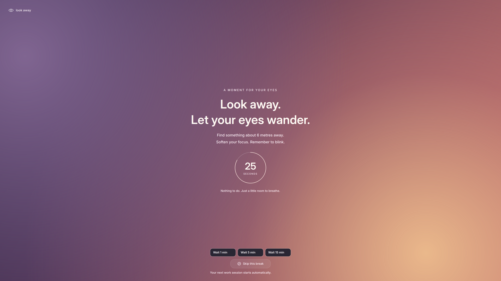
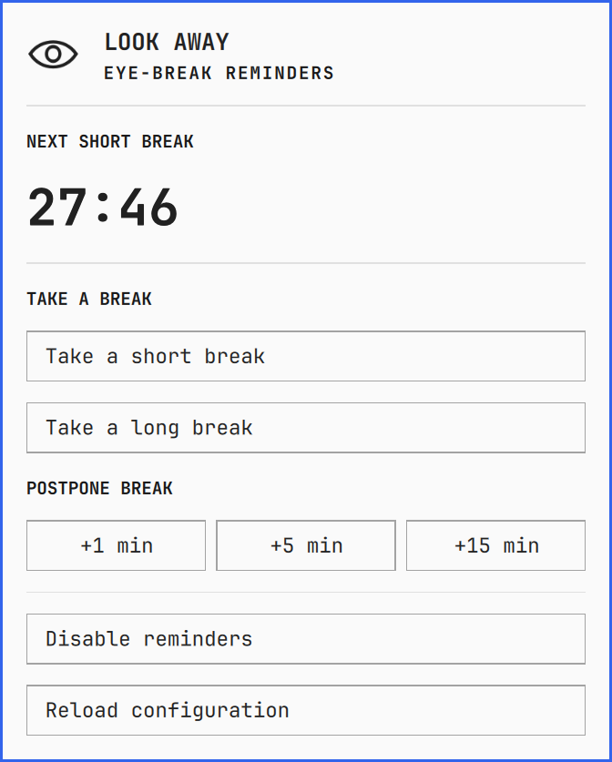

> [!IMPORTANT]
> **VIBECODED USING OPENAI CODEX**
>
> This project was built by prompting Codex to write and iterate on the code. It is an experimental personal project.

# Look Away for Omarchy

A small Omarchy plugin that reminds you to give your eyes a rest. Built for **Hyprland and the current Quickshell-based Omarchy bar**. The bar menu uses Omarchy’s native panel components and follows its theme, fonts, borders, and spacing. The break screen’s soft gradients and typography take visual inspiration from [LookAway](https://lookaway.com/); this is an independent Linux implementation.

## Screenshots

### Break screen

The actual full-screen Wayland overlay, with its live countdown and break controls.



### Omarchy bar menu

The actual menu using Omarchy’s native components and current theme.



## What it does

- Work for **30 minutes**, then look away for **30 seconds**.
- Every fourth completed break lasts **3 minutes** instead: short → short → short → long.
- The bar displays whole minutes, then seconds during the final minute: `30`, `29`, … `2`, `60`, `59`, …
- A click-through heads-up appears **one minute before** a scheduled break and disappears after **8 seconds**.
- A click-through badge follows the pointer during the **last 5 seconds**.
- An opaque Wayland **overlay layer** covers every connected screen during breaks, including the bar and fullscreen apps. It is not a tiled or ordinary fullscreen application window.
- The break screen displays a large countdown and closes automatically when time is up. Then a fresh work session starts.
- **Skip in 5s → 4s → 3s → 2s → 1s**, with circular progress, becomes **Skip this break** after five seconds. The timer enforces the delay.
- **Wait 1 / 5 / 15 min** in both the bar menu and break overlay. During work this adds to the remaining time; during a break it postpones that same kind of break. Overlay controls unlock after five seconds.
- Left-click the eye countdown for the menu; right-click to enable/disable reminders. Manual short and long breaks are available in the menu.

This first version has no idle detection, meeting detection, sounds, or analytics. The pointer position is queried locally only during the final countdown; no input is recorded.

## Install

Requires an Omarchy version with the Quickshell-based shell. There is nothing to build and no background program to manage: the plugin runs inside the Omarchy shell, so it starts whenever your desktop does.

```sh
omarchy plugin add https://github.com/bibstha/look_away_linux.git --enable
```

Remove it, keeping your YAML configuration:

```sh
omarchy plugin remove bibstha.look-away --yes
```

### Upgrading from the Rust version

The app used to be a Rust binary and a systemd user service under the plugin ID `local.look-away`. If you installed that version, remove it before adding the plugin:

```sh
systemctl --user disable --now look-away.service
rm -f ~/.config/systemd/user/look-away.service ~/.local/bin/look-away
rm -rf ~/.local/share/look-away
systemctl --user daemon-reload
omarchy plugin remove local.look-away --yes
```

## Configuration

Edit `~/.config/look-away/config.yaml` (or `$XDG_CONFIG_HOME/look-away/config.yaml`):

```yaml
work_duration: 30m
short_break: 30s
long_break: 3m
long_break_every: 4
warning_before: 60s
warning_duration: 8s
```

Durations accept units such as `s`, `m`, and `h`. Work and break durations must be between one second and seven days. Set `long_break_every: 0` for manual long breaks only. Set either warning duration to `0s` to disable the heads-up. The pointer badge remains enabled for the final five seconds.

Click **Reload configuration** in the menu, or run `omarchy-shell bibstha.look-away reload`. Reload validates the file and starts a fresh work session; a bad file leaves the running timer intact. Partial YAML files inherit defaults. Unknown keys are rejected to catch typos. A missing file uses defaults.

Disabling freezes the work countdown. Disabling during a break dismisses it and prepares a fresh work session; enabling resumes it. An on-demand break enables reminders. Completed short breaks advance the cycle; a completed long break resets it. Skipping or postponing a break does not count it as completed. Restarting the app resets the session and enables reminders. Timing uses a monotonic clock and does not count system suspend as work time on Linux. Desktop locking is not detected in this version.

## Commands

The menu covers everyday use. The same actions are available from a terminal, or for your own key bindings, while the shell is running:

```sh
omarchy-shell bibstha.look-away status       # JSON snapshot
omarchy-shell bibstha.look-away shortBreak
omarchy-shell bibstha.look-away longBreak
omarchy-shell bibstha.look-away snooze 1     # Also accepts 5 or 15; adds minutes
omarchy-shell bibstha.look-away disable
omarchy-shell bibstha.look-away enable
omarchy-shell bibstha.look-away toggle
omarchy-shell bibstha.look-away skip         # Only during breaks, after five seconds
omarchy-shell bibstha.look-away reload
```

## How it works

Like other service plugins, Look Away has one engine (`Service.qml`) per shell, and each bar's widget reads it. The engine also draws the overlays.

- **Sleep:** the countdown only counts time the machine is awake, so waking a laptop does not start a break.
- **Shell restarts:** Omarchy restarts its shell after updates, so the timer state is saved under `$XDG_RUNTIME_DIR`. A restart picks up where it left off. A reboot, or saved state older than two minutes, starts a fresh work session. Time while the shell is down does not count.
- **Crashes:** if the shell stops, so do the timer and overlays, and the bar is gone too, so a hidden timer cannot silently count breaks.

A configuration file with errors is reported in the menu. At startup the plugin runs on defaults; on reload the running timer is left alone.

The overlay is a reminder, not a security lock screen. Hyprland compositor shortcuts remain available.

## Research and defaults

The [American Optometric Association recommends the 20-20-20 rule](https://www.aoa.org/healthy-eyes/eye-and-vision-conditions/computer-vision-syndrome/20-20-20-rule?sso=y): look at something 20 feet away for 20 seconds every 20 minutes. Its guidance also recommends longer rests after sustained computer use. [Oregon OSHA's workstation guide](https://ehs.oregonstate.edu/sites/ehs.oregonstate.edu/files/pdf/ergo/or-osha_evaluating_your_computer_workstation.pdf) describes frequent short breaks and longer breaks depending on work intensity.

The requested **30m / 30s / 3m every fourth break** is a configurable personal schedule, not a medically established prescription. For the common 20-20-20 reminder, set `work_duration: 20m` and `short_break: 20s`. A reminder app cannot establish that you actually looked away.

The compositor integration follows Quickshell's [PanelWindow](https://quickshell.org/docs/v0.2.0/types/Quickshell/PanelWindow/) and [WlrLayershell](https://quickshell.org/docs/v0.2.0/types/Quickshell.Wayland/WlrLayershell/) APIs.

## Development and verification

```sh
./tests/run              # Timer and configuration rules, under Node
./tests/service-restart  # The real service in a private Quickshell; needs a Wayland session
omarchy plugin validate .
```

`tests/run` covers display boundaries, automatic break cycling, warning timing, disable/resume, five-second skip enforcement, additive snoozing and preserved break types, sleep, saved state and configuration validation. `tests/service-restart` covers commands, failed reload recovery and surviving a restart. The bar widget and break screen are checked separately in a live Hyprland session.

Source layout:

- `Model.js`: timer rules and configuration parsing, with no QML.
- `Service.qml`: the running timer, saved state and IPC commands.
- `Overlays.qml`, `BreakView.qml`: the break screen, heads-up and pointer badge.
- `Widget.qml`: the bar widget and menu.

To try local changes, copy the plugin files into `~/.config/omarchy/plugins/bibstha.look-away/`. The shell reloads changed files; a file new to that folder needs `omarchy restart shell`.

MIT licensed.
